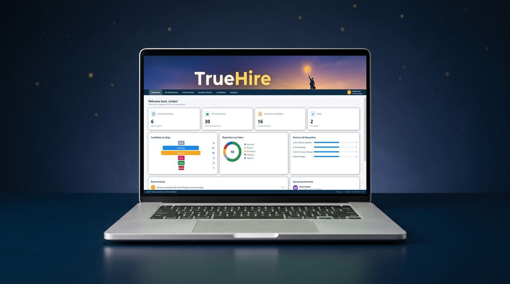
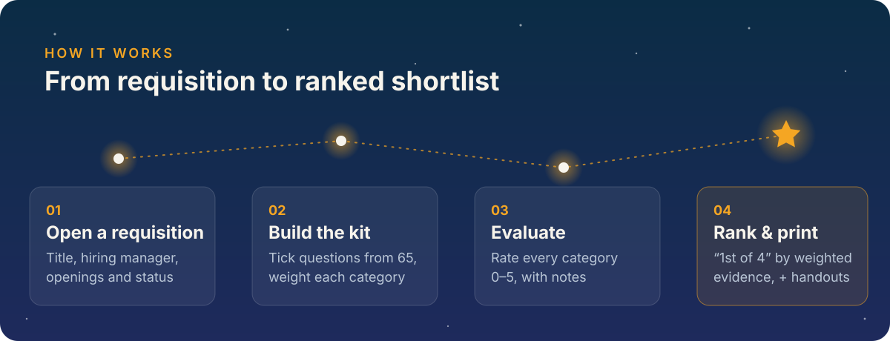
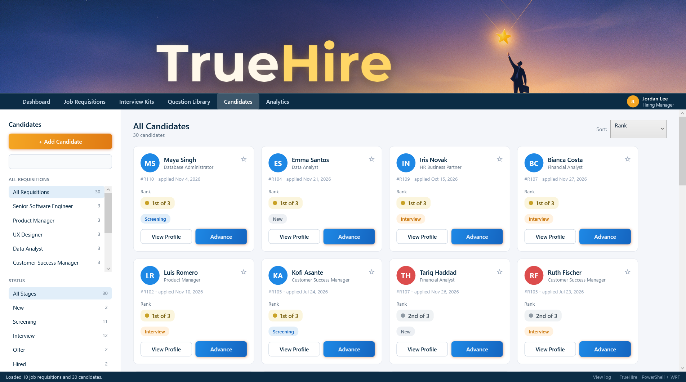
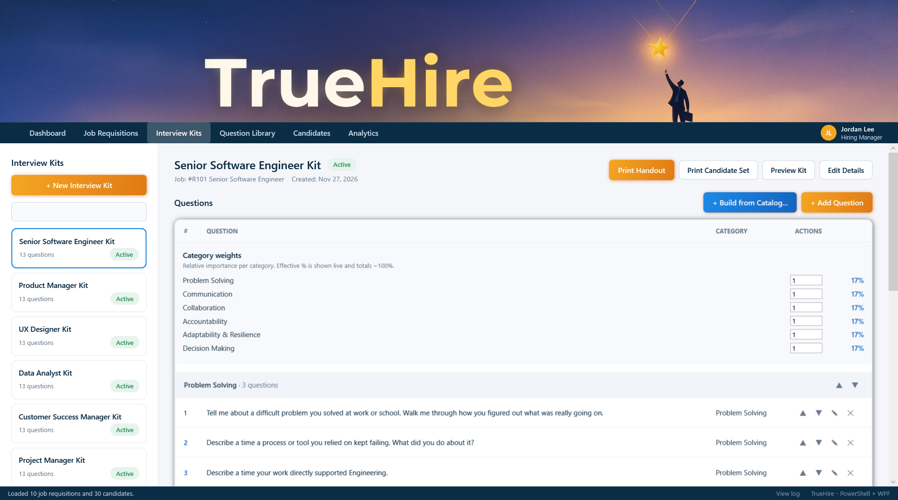
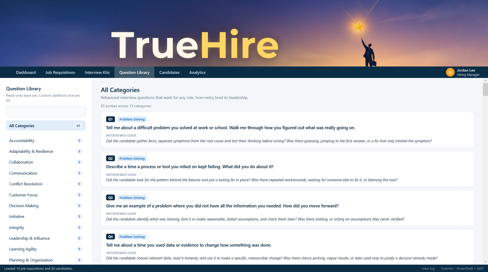
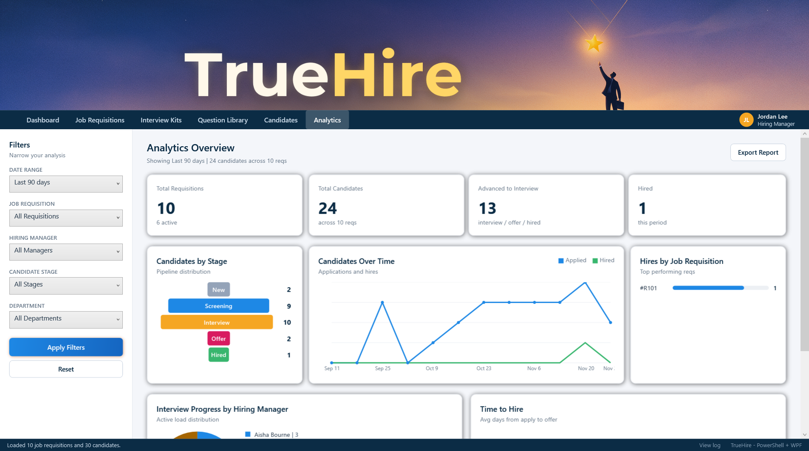
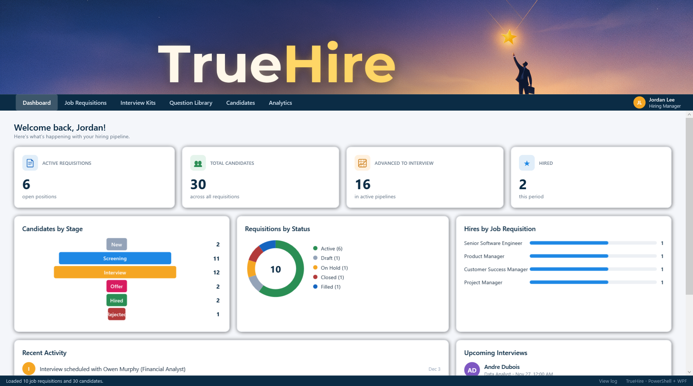
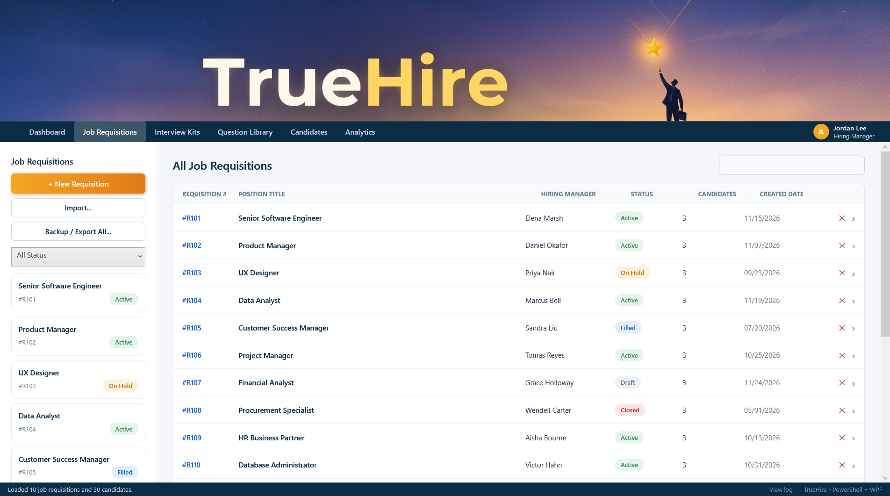
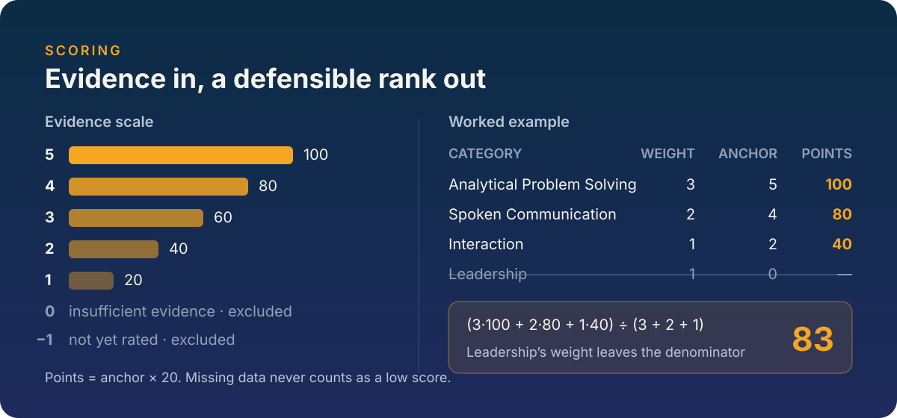

<p align="center">
  
</p>

<p align="center">
  <b>Behavioral interview analytics for hiring managers.</b><br>
  Run structured behavioral interviews end to end, from requisition to evidence-ranked shortlist, in one offline Windows app.
</p>

<p align="center">
  <a href="#quick-start"></a>
  <a href="#requirements"></a>
  <a href="#architecture"></a>
  <a href="#requirements"></a>
  <a href="LICENSE"></a>
</p>

<p align="center">
  <a href="#what-it-does">What it does</a> ·
  <a href="#how-it-works">How it works</a> ·
  <a href="#scoring">Scoring</a> ·
  <a href="#quick-start">Quick start</a> ·
  <a href="#architecture">Architecture</a> ·
  <a href="#testing">Testing</a>
</p>

<p align="center">
  
</p>

## What it does

Structured behavioral interviews are one of the most reliable ways to hire, but most teams run them on spreadsheets, Word templates and paper rating sheets that drift out of sync. TrueHire puts the whole loop in one desktop app and turns every interview into evidence you can compare, weigh and rank, so the hire you make is the one the evidence supports:

- **Requisitions.** Open a job and track its manager, openings, status and dates.
- **Interview kits.** Build the kit from a catalog of 65 behavioral questions in 13 competencies that apply to any role and level, add your own questions, and weight the categories that matter most for the role.
- **Evaluations.** Rate each candidate category by category on a six-point evidence scale, with notes and a Select or Non-Select recommendation.
- **Ranking.** See every candidate ranked within their requisition ("1st of 4") by weighted evidence, not gut feel.
- **Print.** Produce interview handouts, candidate question sets and rating sheets from the same data, then save them as PDFs from the browser.

It needs no installer, no admin rights, no database and no third-party runtime. It uses only Windows PowerShell 5.1 and the WPF assemblies built into Windows, so it runs on locked-down corporate PCs and keeps every record on the local machine.

## Why it's different

| Principle | How TrueHire applies it |
|---|---|
| **Evidence, not impressions** | Every rating is one of six written anchors, from "Very strong evidence skill IS present" to "Insufficient evidence". Interviewers judge what they heard, not how they felt. |
| **Weighted, fair ranking** | Each kit sets a relative weight per category. Unrated or insufficient categories drop out of the math instead of dragging the score down. |
| **One source of truth** | Requisitions, kits, candidates and evaluations are linked records. The handout, the rating sheet and the rank all come from the same data. |
| **The manager still decides** | The score only orders the list. The hiring manager's Select or Non-Select call is recorded separately and never derived from the number. |
| **Zero footprint** | Runs from a folder, a USB stick or one self-extracting `.exe`. Data is JSON on disk, with full and date-ranged backup bundles. |

## How it works

<p align="center">
  
</p>

### The six tabs

| Tab | What you do there |
|---|---|
| **Dashboard** | See open requisitions, total candidates, interviews in progress and hires at a glance, plus the stage funnel, requisitions by status, recent activity and upcoming interviews. |
| **Job Requisitions** | Manage requisitions in a filterable list. Edit details, cascade-delete a job with its kit and candidates (with an optional backup first), and export or import bundles for the whole workspace, a date range or a single requisition. |
| **Interview Kits** | One kit per requisition. Choose **Build from Catalog** and tick the exact probes you want per category, write custom questions and categories, reorder sections, set **category weights**, preview the kit, and print the handout or the candidate question set. |
| **Question Library** | Browse and search all 65 catalog questions and their interviewer guides, with no job or kit needed. |
| **Candidates** | Filter by requisition and stage, sort by rank, and open a candidate to record the evaluation, notes, stage, interview date and recommendation. |
| **Analytics** | Filter by date range, requisition, manager, department and stage. See applications over time, hires by requisition, the interview load per manager and time to hire, and export the report to Excel. |

<table>
  <tr>
    <td width="50%"></td>
    <td width="50%"></td>
  </tr>
  <tr>
    <td align="center"><sub><b>Candidates</b>, ranked within each requisition</sub></td>
    <td align="center"><sub><b>Interview Kits</b>, with per-category weights</sub></td>
  </tr>
  <tr>
    <td width="50%"></td>
    <td width="50%"></td>
  </tr>
  <tr>
    <td align="center"><sub><b>Question Library</b>, 65 questions in 13 competencies</sub></td>
    <td align="center"><sub><b>Analytics</b>, with an optional Excel export</sub></td>
  </tr>
</table>

<details>
<summary><b>More screenshots</b></summary>
<br>

| Dashboard | Job Requisitions |
|---|---|
|  |  |

</details>

### Printable outputs

TrueHire writes self-contained HTML files to `outputs/`. Each one has a **Print / Save as PDF** button that uses the browser's own print dialog, so the app ships with no PDF library.

| Output | Use it for |
|---|---|
| **Interview handout** | The interviewer's copy, with one question per page: the category, the probe, the interpretive guide and note lines. |
| **Candidate question set** | A compact questions-only copy to hand to the candidate, without the scoring guidance. |
| **Rating sheets** | A blank anchor grid for each interviewer, or a filled sheet with the evaluation and the recommendation. |

## Scoring

<p align="center">
  
</p>

Each rated category earns **anchor × 20** points. The candidate's score is the weighted mean across the categories that were actually rated:

```text
score = Σ(weight × points) / Σ(weight)        over categories with anchor 1–5
```

- **Insufficient evidence (0)** and **not yet rated (−1)** are missing data. They drop out, and their weights leave the denominator.
- A category with no weight set counts as `1`. If every rated category has weight `0`, the score falls back to an equal-weighted mean.
- The score orders the **Candidates** list and appears in the Excel report. It stays off the Dashboard on purpose, because a company-wide "match %" would claim more precision than a qualitative rubric has.

[`docs/weighted-rating-explained.html`](docs/weighted-rating-explained.html) has more worked examples, and [`docs/weighting-scoring-demo-guide.html`](docs/weighting-scoring-demo-guide.html) is a five-minute live demo script.

## Quick start

```powershell
git clone https://github.com/HarrisonAlexander/TrueHire.git
cd TrueHire
powershell -ExecutionPolicy Bypass -File .\TrueHire.ps1
```

You can also double-click **`Run-TrueHire.cmd`**.

The app starts empty. To explore it with realistic data, open **Job Requisitions → Import...** and choose **`data/demo-full.truehire.zip`**. That loads 10 requisitions, 10 interview kits and 30 evaluated candidates.

### Requirements

- Windows 10 or 11
- Windows PowerShell 5.1 and .NET Framework 4.7.2 or later (both built into Windows)
- *Optional:* [ImportExcel](https://github.com/dfinke/ImportExcel) for the Analytics **Export Report** button. The button disables itself when the module is missing.

```powershell
Install-Module ImportExcel -Scope CurrentUser
```

### Where your data lives

| Mode | Location | How to turn it on |
|---|---|---|
| Default | `%APPDATA%\TrueHire\` | Nothing to do |
| Portable | `<app folder>\userdata\` | Put an empty `portable.flag` file next to `TrueHire.ps1` |
| Packaged `.exe` | `<exe folder>\userdata\` | Set automatically by the launcher |

Records are plain JSON. **Backup / Export All** writes a `.truehire.zip` bundle that you can import on another machine. Re-importing the same bundle merges by job, so it never creates duplicates.

## Architecture

The app is about 10,000 lines of PowerShell in four layers, all dot-sourced into one script scope. It uses no MVVM framework, no data-binding library and no charting library. The charts are hand-drawn with `ArcSegment` and `PathGeometry`.

```text
TrueHire.ps1        entry point: load WPF, dot-source lib + views, hydrate data, show the shell
lib/
  Logging.ps1        daily rolling log + DispatcherUnhandledException capture
  Theme.ps1          shared XAML ResourceDictionary, window factory, 1.2× UI scale
  Data.ps1           JSON I/O, model factories, versioned migrations, aggregation
  Helpers.ps1        WPF builders (pills, avatars, charts), scoring + ranking, metrics
  HtmlOutput.ps1     printable handouts and rating sheets
  ReportExcel.ps1    optional ImportExcel-backed analytics workbook
  Export.ps1         .truehire.zip bundles: full, date-ranged, per requisition
views/
  Shell.ps1          main window + tab router
  *.ps1              one XAML here-string + one Show-*View function per tab
```

```text
JobRequisition ──1:1── InterviewKit ── categories[] (weight) ── questions[]
      │
      └──1:N── Candidate ── evaluation { ratings: { categoryId: { anchor, note } }, recommendation }
```

### Engineering notes

- **Versioned, score-preserving migrations.** The rating scale was inverted from "1 is strongest" to "0–5, with 5 strongest". Data already on disk is remapped exactly once, guarded by a marker on each record, and the remap keeps every existing score the same.
- **Delete-safe derived state.** A legacy ratings mirror is always rebuilt from scratch rather than merged, so a deleted evaluation can never come back on the next load.
- **WPF events in PowerShell's scope model.** Handlers avoid `.GetNewClosure()`, which captures a copy of script scope and silently drops state writes. Per-item context rides on each control's `.Tag` instead. [CLAUDE.md](CLAUDE.md) lists this and the other PowerShell + WPF pitfalls, each with a reproduction.
- **Design first.** Every major feature started as a written spec and an implementation plan, kept in [`docs/specs`](docs/specs) and [`docs/plans`](docs/plans).

## Testing

```powershell
# Headless gate: parses every view and dialog XAML, renders each into a host Grid,
# and checks metrics, export/import round-trips, weighted scoring, reordering and ranking.
powershell -NoProfile -ExecutionPolicy Bypass -File .\test\smoke.ps1

# Windowed: boots the real shell, cycles every tab, and closes itself.
powershell -NoProfile -ExecutionPolicy Bypass -File .\test\launch.ps1
```

Run `smoke.ps1` after any change to a view or the library. Each check prints `OK` or `FAIL`, and a failure includes the script stack trace.

## Build a single `.exe`

```powershell
powershell -NoProfile -ExecutionPolicy Bypass -File .\build\Build-Exe.ps1
```

This produces `dist\TrueHire.exe`, a small .NET launcher compiled with the `csc.exe` that ships with Windows. The app's scripts are embedded inside it as a zip. On first run it extracts them to `%LOCALAPPDATA%\TrueHire\<hash>\` and starts PowerShell against that copy. To distribute it, attach the `.exe` to a GitHub Release rather than committing it.

## Project layout

```text
├── TrueHire.ps1 · Run-TrueHire.cmd   entry point and launcher
├── lib/ · views/                       application code
├── data/                               question catalog, job titles, seeds, demo bundle
├── images/                             in-app banner and logo
├── assets/readme/                      README artwork (sources in assets/readme/source)
├── test/                               smoke and launch tests
├── tools/                              demo-data generator, screenshot capture, reset script
├── build/                              exe launcher source and build script
└── docs/                               scoring explainers, design specs and plans, screenshots
```

## Changelog and license

User-facing history is in [CHANGELOG.md](CHANGELOG.md). TrueHire is released under the [MIT License](LICENSE).
